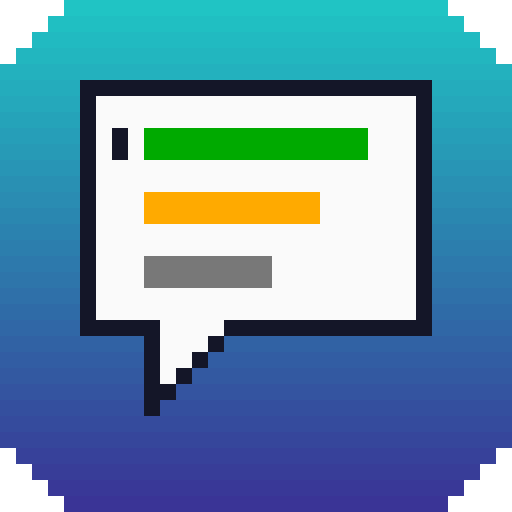
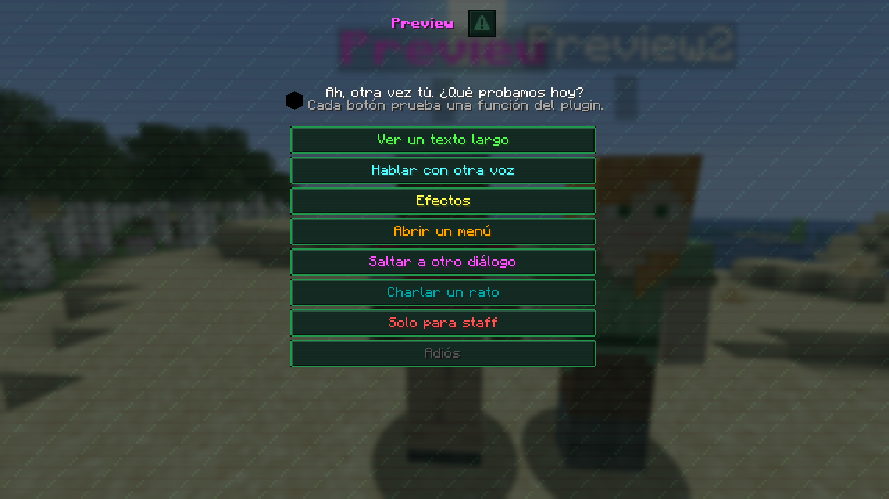
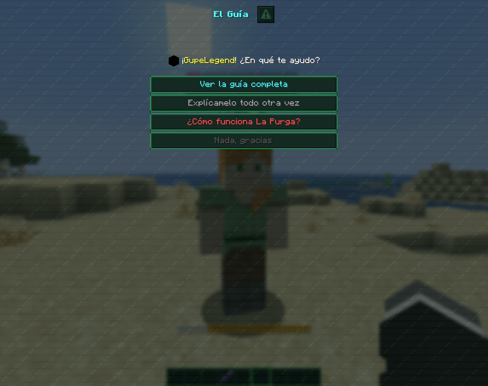
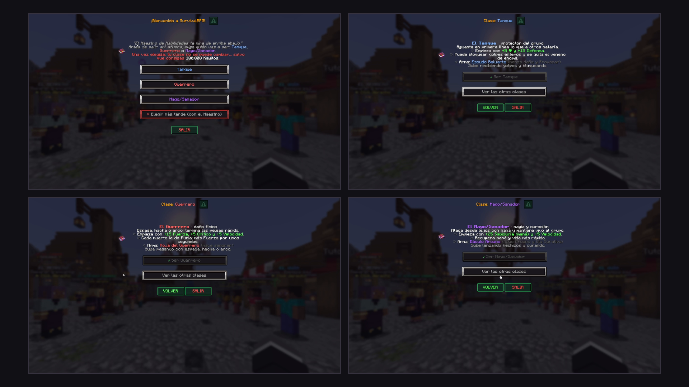
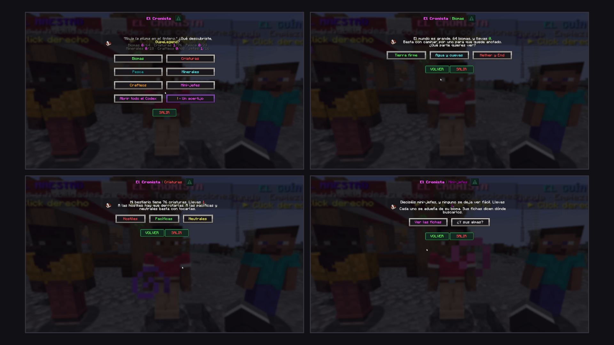
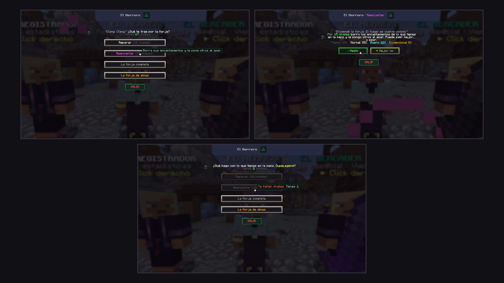
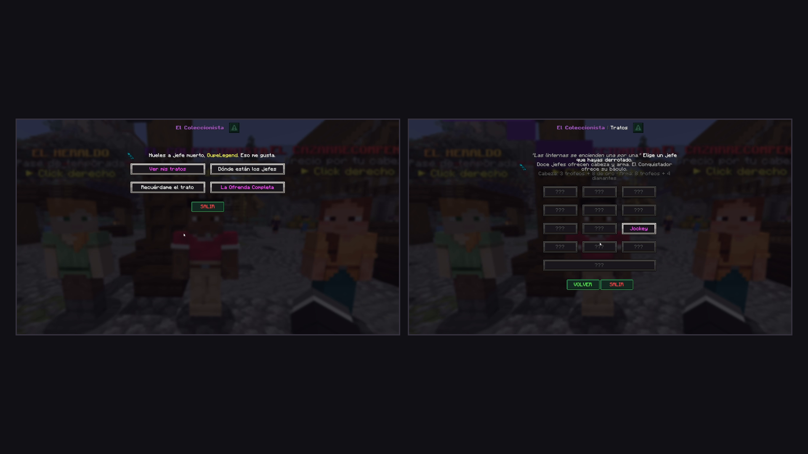

<p align="center"></p>

# UltraDialogue

[](https://papermc.io)
[](https://papermc.io)
[](https://adoptium.net)
[](LICENSE)

**Real dialogue screens for your NPCs** — a portrait, what the character says, and the player's
answers as buttons. Every answer can branch the conversation, open a menu or run commands.

A Paper plugin by **Social Studio**.

It uses the **native dialog screens** Minecraft introduced in client version 1.21.6. The
same JAR runs on **Paper 26.1, 26.2 and 26.3 / Java 25**. No client mod is required.
Native buttons and plain free-row text need no resource pack; the optional RPG panel appearance
uses the button pack bundled with the plugin, which it installs in your server's pack plugin.

## Screenshots from a configured server

<p align="center">
  
  
</p>
<p align="center">
  
  
</p>
<p align="center">
  
  
</p>
<p align="center">
  
  
</p>

Each image groups real frames of the same kind of screen. NPCs, the world, quests, Codex content, fonts and other
server resource-pack customisations shown here are not supplied with the plugin.

---

## Features

- **A button editor in `/ud`** *(1.1.3)*: an in-game menu for admins to pick a dialogue, a node and
  edit its buttons — text, icon and position — without opening a text editor. It only touches
  buttons: the NPC's own lines, conditions, actions and affinity are still edited in the file.
  "Save" writes straight to that node's `answers:`/`nav:`, leaving the rest of the file untouched.
- **Branching conversations** written in YAML: nodes, answers, and where each answer leads.
- **Actions on any answer:** go to another node or dialogue, open a menu, run a player or console
  command, send a message / title / action bar, play a sound.
- **Button sizes and icons**: four button sizes like the pause menu (from the tiny square to full
  width) and a set of quest symbols *(1.1.2)* — quest, main / side quest / riddle markers, accept,
  back, exit, reward, story and chance. Plain text: no resource pack.
- **The NPC's face** *(1.1.1)*: a 2D face from the NPC's skin next to its name.
- **Free layouts** *(1.1.2)*: `layout: [1, 2, 2, 1]` puts any number of buttons on each row — the
  shape Minecraft's own dialog grid can't do.
- **RPG buttons** *(1.1.2)*: with the optional button pack (offered after join when delivery is enabled), those
  buttons use a flat dark background and a double border coloured by their function. The same
  simple design applies to every NPC and chapter. Without the pack: `[ text ]`.
- **Locked answers and navigation** *(1.1.2)*: answers you can't pick yet show greyed out with a
  hint, a **Back** button that remembers the way, an **Exit** pinned to the bottom, and per-node
  titles.
- **Deliveries** *(1.1.1)*: check, take and give items — vanilla, UltraBoss trophies, or any item by
  its hidden tag, model or name. Taking is all-or-nothing and is checked again on click (no dupes).
- **Story locks and quests** *(1.1.1)*: conditions on BeautyQuests quests (`quest: completed 12`),
  its own BeautyQuests stage type, and placeholders for affinity and flags.
- **Conditions** that hide answers or change where a talk starts — permissions, player flags, and any
  PlaceholderAPI placeholder (`%vault_eco_balance% >= 1000`).
- **Player flags**: remember that someone already met a character, accepted a job or finished a
  step, and greet them differently next time. Stored on the player, no database.
- **Affinity** *(1.1)*: a hidden friendship level per player and per character. Kind answers raise
  it, rude ones lower it, and new greetings, questions and secrets unlock as it grows. Players are
  never told the number changed.
- **Conversations that never repeat** *(1.1)*: several variants per line (a different one every
  time) and questions that rotate, so talking to the same NPC twice doesn't feel scripted.
- **Portraits**: the NPC's own skin, any player's skin, a fixed texture, or any item.
- **FancyNpcs support out of the box**: link a dialogue to an NPC by name and clicking it opens the
  talk *instead of* its FancyNpcs actions. Your `npcs.yml` is never touched.
- **Any entity** can talk too, with a tag: `/tag @e[type=villager,limit=1,sort=nearest] add dialogue:merchant`.
- **Old clients** joining through ViaVersion (< 1.21.6) get the same conversation in chat, with
  clickable answers.
- **English and Spanish** built in.

## A dialogue

One file per character in `dialogues/`. The file name is the id.

```yaml
name: '&2&lThe Wandering Merchant'
npcs: [merchant]                    # FancyNpcs NPC names
portrait: 'npc | item:EMERALD'      # the NPC skin, or an emerald if it has none
start:
  - if: '!flag:met_merchant'        # first time...
    node: intro
  - node: hello                     # ...and every time after
nodes:
  intro:
    on-show: ['flag: met_merchant']
    text:
      - 'Psst! You, the one with empty pockets. Come closer.'
    next: hello                     # no answers = a "Continue" button
  hello:
    text: 'My stock changes every &fMonday&f.'
    answers:
      - text: '&2Show me your goods'
        actions: ['menu: shop']     # opens a DeluxeMenus menu
      - text: '&7Where do you get all this?'
        tooltip: '&7Hover text'
        goto: secret
      - text: '&8Not interested'
        goto: end
  secret:
    text: 'A good merchant never reveals his suppliers.'
```

`dialogues/example.yml` documents every option with comments.

### Actions

| Action | What it does |
|---|---|
| `goto: node` | Go to another node (`end` finishes the talk) |
| `dialogue: id [node]` | Switch to another dialogue |
| `menu: name` | Open a menu (runs `menu-command` from config.yml, DeluxeMenus by default) |
| `command: spawn` | Run a command as the player |
| `console: give %player% diamond 1` | Run a command from the console |
| `message:` · `broadcast:` · `actionbar:` | Text to the player / everyone / action bar |
| `title: Title\|Subtitle` | On-screen title |
| `sound: entity.villager.yes 1 1` | Also accepts `ENTITY_VILLAGER_YES` |
| `flag: x` · `unflag: x` | Set or remove a player flag |
| `affinity: +2` · `affinity: -3` · `affinity: =10` | Change affinity with this character (`affinity: kadir +2` for another one) |
| `close` | Close the screen |

When an answer ends the talk (opens a menu, runs a command…) the screen closes **before** the
actions run, so the menu stays open.

### Conditions (`if:`)

Every line of the list must match; inside a line, `||` means "or".

```
permission:group.vip       !permission:group.vip
flag:met_merchant          !flag:met_merchant
%vault_eco_balance% >= 1000          ( ==  !=  >=  <=  >  <  contains )
affinity >= 20             affinity:kadir >= 20
```

## Affinity and conversations that change

Every player has a hidden **affinity** with every character, starting at 0. Answers change it, and
conditions read it — so the same NPC can be cold with strangers and open up to friends:

```yaml
start:
  - if: 'affinity >= 25'
    node: friend
  - node: stranger

nodes:
  stranger:
    variants:                        # a different one each time, never the same twice in a row
      - 'Yes? What do you want?'
      - "I don't usually talk to strangers."
    show: 2                          # only 2 of these questions appear, picked at random
    answers:
      - text: '&7Hello. Who are you?'
        actions: ['affinity: +2']
        goto: who
      - text: '&8Out of my way.'
        actions: ['affinity: -3']
        goto: end
      - text: '&8Goodbye.'
        always: true                 # never rotated out
        goto: end
```

- **The player never sees the number** and is never told it changed. Staff can check it with
  `/ud affinity <player> <id>`.
- **Anti-farming:** a character only *gives* affinity once every `cooldown-minutes` (30 by default),
  and at most `max-per-talk` points (3) per conversation. Losing affinity has no limit.
- Defaults live in `config.yml` under `affinity:`; each dialogue can override them with its own
  `affinity:` section.
- It only exists in dialogues that use it. Menu NPCs that don't mention affinity behave exactly as
  before.
- A variant can have its own `if:` (`{text: ..., if: 'affinity >= 10'}`).

`dialogues/kadir.yml` is a complete example with four friendship levels, rotating questions and a
one-time gift.

## Button sizes and icons

```yaml
nodes:
  confirm:
    text: 'Will you take the job?'
    columns: 2                 # this node only: two buttons per row
    answers:
      - text: '&aYes'
        icon: accept
        size: 2                # half width, like "Options..."
        goto: accepted
      - text: '&cNo'
        icon: exit
        size: 2
        goto: end
      - text: ''
        icon: story            # size 1 fits only the icon, like the "report" button
        size: 1
        tooltip: '&7What is this job?'
        goto: details
```

| Size | Width | Like in the pause menu |
|---|---|---|
| `size: 1` | 20 px | the small square "report" button |
| `size: 2` | 98 px | "Options...", half width |
| `size: 3` | 150 px | a medium button |
| `size: 4` | 204 px | "Disconnect", full width |
| `width: 130` | any, 1–1024 | exact width |

Native buttons are 20 px tall. Pack-drawn free-row panels are 24 px tall. `columns:` works on
the native grid for the whole dialogue or a single node; `layout:` controls free rows.

**Icons** (`/ud icons` lists them in game). Since 1.1.2 they're **text symbols**, so they look the
same with or without a resource pack:

| Name | English | Symbol | Meaning |
|---|---|---|---|
| `mision` | `quest` | `!` (orange) | there's a quest |
| `principal` | `main` | `•` (green) | marker: main quest |
| `secundaria` | `side` | `•` (blue) | marker: side quest |
| `acertijo` | `riddle` | `•` (purple) | marker: riddle |
| `aceptar` | `accept` | `✓` (green) | accept |
| `volver` | `back` | `«` | back |
| `salir` | `exit` | `×` (red) | exit |
| `premio` | `reward` | `±` (yellow) | quest rewards |
| `cuento` | `story` | `♪` (light blue) | a story the NPC tells for a quest |
| `probabilidad` | `chance` | `%` | something may happen (or drop) by chance |

**Several icons on one button**, separated by spaces: `icon: quest side` shows `! •` with the blue
marker. `[quest, side]` and `quest+side` work too.

> **1.1.2 replaced the 20 pixel-art icons of 1.1.1** (`heart`, `gem`, `gift`, `star`, `shop`…). An icon
> that no longer exists doesn't break anything: the button shows without it and the console warns once
> per dialogue. Text symbols need no pack. Update removed icon-only answers so their labels are not
> blank.

**The NPC's face:** portraits `npc`, `player:Name` and `texture:...` now show as a 2D face from the
skin, next to the NPC's name. The client renders the face; player-name portraits can also use
asynchronous profile resolution through the server API. `item:` portraits show the item on the left.

## Locked answers, Back and Exit

```yaml
nodes:
  quests:
    title: '&6Quests of Brann'        # screen heading for this node only
    text: 'Pick a job.'
    columns: 2
    answers:
      - text: 'Side quest A'
        icon: quest
        size: 2
        goto: job_a
      - text: 'Friends only'
        icon: quest
        size: 2
        if: 'affinity >= 20'
        locked: '&7Brann needs to trust you more.'   # greyed out instead of hidden
        goto: job_b
      - text: 'Main quest'
        icon: quest
        size: 4                         # full width: moved to the last row by itself
        goto: main
    nav:
      - back                            # previous screen of this conversation
      - text: '&eReward'                # any answer works as a nav button
        actions: ['console: give %player% emerald 1']
      - exit                            # pinned to the bottom of the screen
```

- **`locked:`** needs an `if:`. While the condition fails the answer shows in `screen.locked-color`
  and clicking it only shows the hint in the action bar. `locked: true` uses the language's text.
  It's re-checked on every click like any answer, so nothing runs while it's locked.
- **`back`** walks back through the screens of this conversation, even into another dialogue. On
  the first screen it closes the talk (it's always shown, so the grid keeps its shape).
- **`exit`** goes in the footer. Minecraft only has room for **one** fixed button there, so `back`
  and the rest of `nav:` go in the last row of the grid.

## Free layouts (`layout:`)

```yaml
nodes:
  menu:
    title: '&6Quests of Brann'
    text: 'What do you want to ask?'
    layout: [1, 2, 2, 1]          # buttons per row, top to bottom
    answers:
      - {text: '&fMain quest', icon: quest main, goto: main}
      - {text: '&fSide quest', icon: quest side, goto: q1}
      - {text: '&fSide quest', icon: quest side, goto: q2}
      - {text: '&fRiddle', icon: quest riddle, if: 'affinity >= 10', locked: '&7Not yet.', goto: q3}
      - {text: '&fA story', icon: story, goto: q4}
      - {text: '&7Just passing by', goto: end}
    nav:                           # real buttons, all on one row, in this order
      - back
      - exit
      - {text: '&eReward', icon: reward, actions: ['console: give %player% emerald 1'], goto: menu}
```

- Rows are filled with the answers in order. Answers left over go one per row.
- **`nav:` buttons are real Minecraft buttons, all on one row** at the bottom, in the order you write
  them — so `back`, `exit` and a "Reward" sit side by side (with columns = number of buttons, the
  native grid allows it). Without `nav:`, a "Goodbye" button goes at the bottom.
- **How it works:** Minecraft only lets servers lay out real buttons in a uniform grid, but the
  text in the dialog body is clickable and every line is free. In this mode each button is a piece
  of text with its own click, drawn as `[ text ]` and padded with spaces so all rows line up. The
  plugin measures the text with the real Minecraft font, so columns stay aligned within a few pixels.
- **Trade-off:** the text buttons don't light up on hover like real ones (the tooltip still shows);
  the `nav:` row does, since those are real. If you want every button real, leave `layout:` out.
- Use `locked:` instead of a bare `if:` when you can: a hidden answer shifts every button after it to
  another row. The console warns when the number of answers doesn't match the layout.
- Change the look in `config.yml` → `screen.layout`: `button-format` / `locked-format` (`{text}` is the
  answer) and `gap` (spaces between buttons).

### RPG buttons

Players who loaded the plugin's pack see every `layout:` button as a panel: a background, a border
tinted by the button's type, and the text centred on top. Everyone else sees `[ text ]`. Nothing
else changes — the pack only draws.

```yaml
# config.yml → screen.layout
buttons: auto           # auto = loaded pack only · pack = merged/external pack · text = plain text
row-width: full
look: filled
style: liso
border: doble
force: true             # same background and border on every dialogue
force-colors: true      # semantic colours, ignoring per-dialogue colour overrides
border-colors:
  default: '#FFFFFF'    # question / no icon
  mision: '#F2B21E'
  principal: '#4CD964'
  secundaria: '#4F8BFF'
  acertijo: '#B36BFF'
  aceptar: '#4CD964'
  volver: '#C6E86B'
  salir: '#E04B4B'
  premio: '#FFD23F'
  cuento: '#7FD6FF'
  probabilidad: '#FF9F43'
  locked: '#5A5A5A'
```

The active appearance is **simple for all panels**: no biome scenes, no themed textures, just a
flat dark interior and a double frame. The last coloured icon sets the frame colour:
`icono: mision secundaria` draws a gold `!`, a blue `•`, and a blue frame. Locked panels are grey.

**The bundled pack is slim** *(1.1.3)*: it only ships the `liso` background and the `doble` border,
so the jar is a tenth of its previous size. Older style/border names are still accepted in YAML
(`validFill`/`validBorder` don't flag them as typos), but at render time anything other than
`liso`/`doble` falls back to them, with a one-line, once-per-name console notice — no missing
textures, no errors. To restore per-dialogue `style`/`border` (still limited to what the slim pack
ships), set `force: false`; to enable `border-color`/`fill-color` overrides, set `force-colors:
false`. The default uniform theme needs neither. Native `nav:` buttons are unchanged.

**How:** the pack adds a font, `ultradialogue:boton`, whose "letters" are button pieces — caps,
segments of 1 to 128 px and negative spaces. The plugin lays them out to the exact width, draws the
border on top (tinted with the text colour, so any colour works without touching the pack) and
centres the label. The plugin never sends the pack itself: it installs it in your server's pack
plugin (see [Pack delivery](#pack-delivery-and-updates)).

Buttons are 24 px tall (the background inside a 4 px frame). `row-width: full | fit | <px>` chooses
between rows that line up and rows as wide as their text. The pack also darkens Minecraft's in-world
menu background so the world behind the dialogue doesn't distract (every in-world menu is affected).

**Limits (Minecraft's, not the pack's):** panels don't light up on hover, and only the text line in
the middle of the panel is clickable. The `nav:` row is made of real buttons and does light up.

### What the screen can and can't do

Minecraft splits a dialog's buttons into rows of `columns` buttons each. **Only one leftover button
at the very end gets a row of its own.** So:

| Layout | Possible? |
|---|---|
| 2 + 2 + 1 (full-width last) | ✅ — UltraDialogue moves the `size: 4` answer there for you |
| 1 + 2 + 2 (full-width first) | ❌ with real buttons · ✅ with `layout:` |
| 2 + 2 + 2 + Exit fixed at the bottom | ✅ |
| Two fixed buttons at the bottom | ❌ — one fits; put the rest in `nav:` |
| Two-line buttons | ❌ — buttons are one line, 20 px tall |
| Three small buttons on one row (Back · Exit · Reward) | ✅ with `layout:` + `nav:` |
| Any row shape (1-2-2-1, 3-1, ...) | ✅ with `layout:` (text buttons) |

The pause menu does 1-2-2-1 with real buttons because it's built into the client; server dialogs
can't ask for that, which is why `layout:` uses text buttons instead.

## Deliveries

| Condition | Action |
|---|---|
| `has: IRON_INGOT 16` (`tiene:`) — anywhere in the inventory | `take: IRON_INGOT 16` (`quitar:`) — all or nothing |
| `hand: IRON_INGOT 16` (`mano:`) — main hand only | `give: IRON_INGOT 16` (`dar:`) |

Items can be written as:

| Format | Matches |
|---|---|
| `IRON_INGOT` / `minecraft:iron_ingot` | that vanilla item — **only plain ones**: items with a plugin's hidden tag or their own model don't count, so a plain item never takes an UltraBoss trophy |
| `ultraboss:<id>` | an UltraBoss item (also the ones from its older names) |
| `ultrarevive:self` / `boost` / `end` | an UltraRevive totem |
| `pdc:<namespace:key>=<value>` | any plugin's hidden tag |
| `item_model:<namespace:model>` | by item model |
| `name:&6Cellar Key` (`nombre:`) | by display name (last resort) |

```yaml
deliver:
  text: 'Did you bring the iron for the forge?'
  answers:
    - text: '&aHand over 16 iron ingots'
      icon: accept
      if: 'has: IRON_INGOT 16'
      actions:
        - 'take: IRON_INGOT 16'
        - 'give: EMERALD 4'
        - 'affinity: +3'
      goto: thanks
    - text: "&8I don't have them yet"
      if: '!has: IRON_INGOT 16'
      goto: end
```

- **`take:` is atomic**: it counts first and takes nothing if there isn't enough. Main hand first,
  then the rest of the inventory.
- **If `take:` fails, the rest of that answer's actions are cut** — a reward is never given without
  collecting first. The player gets the `item-missing` message.
- **Conditions are checked again when the button is clicked.** Open the dialogue with 16 ingots,
  drop them, press "Hand over": nothing is taken, nothing is given, the screen redraws.
- `give:` builds vanilla items itself; UltraBoss and UltraRevive items are given through their own
  command, so they come out with every tag, name and texture.
- A start rule can react to what the player is holding: `if: 'hand: IRON_INGOT 16'`.

## Story locks and BeautyQuests

Use quests (or flags, or affinity with another character) to decide what an NPC says — so players
can't skip to the end of the story:

```yaml
start:
  - if: '!quest: completed 12'
    node: too_early              # "What are you doing here? You haven't even found the key."
  - node: final_scene
```

| Condition | True when |
|---|---|
| `quest: completed <id>` (`mision: completada`) | the player finished that BeautyQuests quest |
| `quest: started <id>` (`mision: en-curso`) | it's started and not finished |
| `quest: active <key>` (`mision: activa`) | the player is **right now** at an `ULTRADIALOGUE` stage with that key |

| Action | What it does |
|---|---|
| `quest: complete <key>` (`mision: completar`) | completes every `ULTRADIALOGUE` stage with that key the player is on |
| `quest: start <id>` (`mision: empezar`) | starts the quest, respecting its requirements |
| `quest: force <id>` (`mision: forzar`) | starts it without requirements |

**The `ULTRADIALOGUE` stage type.** UltraDialogue registers its own stage in BeautyQuests, so an NPC
with a dialogue can take part in quests natively:

```yaml
# in the BeautyQuests quest file
'3':
  stageType: ULTRADIALOGUE
  key: brann_iron
  npc: brann                  # optional, only for the description
  customText: '§7Bring §f16 iron ingots §7to §fBrann'
```

```yaml
# in the dialogue
- text: '&aHand over the iron'
  icon: accept
  if: ['quest: active brann_iron', 'has: IRON_INGOT 16']
  actions: ['take: IRON_INGOT 16', 'quest: complete brann_iron']
```

It can also be created from BeautyQuests' in-game editor (it asks for the key). Two quests on the
same key both advance.

`quest: complete` fires a plain Bukkit event, **`DialogueSignalEvent(player, key)`** — any plugin can
listen to it, with or without BeautyQuests.

**Without BeautyQuests** everything still loads: quest conditions are false, `start`/`force` do
nothing, and the console says so once per dialogue.

## Placeholders

With PlaceholderAPI:

| Placeholder | Value |
|---|---|
| `%ultradialogue_affinity_<id>%` | the player's affinity with that character |
| `%ultradialogue_flag_<flag>%` | `true` / `false` |

Use them as real quest requirements in BeautyQuests (`placeholderRequired`), to lock menu items in
DeluxeMenus, or anywhere else.

## Commands and permissions

All administrative commands require `ultradialogue.admin` (op by default). Aliases: `/ud`,
`/dialogue`, `/dialogo`. The legacy `dialogos.admin` permission grants it too.

| Command | |
|---|---|
| `/ud` or `/ud editor` | Open the button editor (in-game only; see below) |
| `/ud open <id> [player] [node]` | Open a dialogue by hand — works from console and from other plugins |
| `/ud reload` | Reload config, language and every dialogue |
| `/ud list` | Loaded dialogues and their NPCs |
| `/ud flags <player> [clear [flag]]` | See or clear a player's flags |
| `/ud affinity <player> [id] [set\|add\|reset] [n]` | See or change affinity (staff only; `add` ignores the anti-farming limits) |
| `/ud icons` | Every icon with its name, drawn the way that player sees them |

Players need no permission to talk to NPCs.

## Button editor (`/ud`)

`/ud` with no arguments (or `/ud editor` explicitly) opens an in-game menu: pick a dialogue, pick
one of its nodes, and see its buttons — the main answers and the `nav:` row.

For each button you can:

- **Edit its text** — the menu closes, you type the new line in chat (or `cancel` to leave it as
  it is), and the menu reopens.
- **Change its icon** — one of the 10 approved presets, or none.
- **Change its size** — cycles through auto / 1 / 2 / 3 / 4 (right-click to go backwards).
- **Move it up or down**, or, on a node with `layout:` rows, **move it to another row**.
- **Delete it**, with a confirmation step.
- **Add a new one** — pick an existing button as a template (its `goto`, `actions` and conditions
  are copied as-is), then edit its text and icon.

"Test" opens the dialogue for you as it is currently *saved*; "Save" writes the buttons to the
dialogue's file (see [Notes for contributors](#notes-for-contributors) for how little of the file
that touches); "Cancel", or just closing the menu, discards anything not saved yet.

This menu never touches the NPC's own lines, its conditions, actions or affinity — those stay in
the dialogue's `.yml` file, exactly as documented above. The permission is the same
`ultradialogue.admin` as every other `/ud` subcommand.

## Requirements

| | |
|---|---|
| **Server** | Paper, Purpur or Folia, on 26.1, 26.2 or 26.3 (one JAR, built against 26.1.2) |
| **Java** | 25 |

The older-client ViaVersion fallback does not imply support for older servers.
Bedrock players (Geyser + Floodgate) see the dialogues as Bedrock forms:
they always get the text buttons, and `layout:` rows become normal buttons for them, since text in
a form can't be clicked.

Everything else is optional and detected at runtime:

| Plugin | Used for |
|---|---|
| FancyNpcs | Clicking an NPC opens its dialogue |
| PlaceholderAPI | Placeholders in text, actions and conditions |
| DeluxeMenus | The `menu:` action (any menu plugin works — change `menu-command`) |
| ViaVersion | Sends old clients the chat version |
| BeautyQuests 2.1 | Quest conditions and actions, the `ULTRADIALOGUE` stage type |
| Floodgate | Knowing who plays on Bedrock (text buttons, rows as buttons) |
| ResourcePackManager, Nexo, Oraxen, ItemsAdder, CraftEngine or EcoItems | Where the button pack is installed |

## Install

Drop the jar in `plugins/` and start the server. Three example dialogues are created.

Symbols do not need a pack. For the RPG panels, the plugin installs its button pack in the plugin
that builds your server's pack (see below). In `buttons: auto`, a player gets panels once the
server's pack has loaded on their client; refusal or a failed download leaves the text
presentation. `buttons: pack` always draws them.

Data lives in **`plugins/UltraDialogue/`**, its own normal Bukkit data folder. Upgrading from a
version that still used the shared `plugins/UltraView/UltraDialogue/` folder moves everything over
automatically the first time it starts (logged once; the old folder is removed only once it's
empty). Your config and dialogues are never overwritten on update.

When you edit a dialogue, run `/ud reload`. If something is wrong the console tells you **which file,
which node and which reference** is broken. Close and reopen active conversations after reloading
their definitions: `/ud reload` does not cancel existing sessions. `resource-pack` changes need a
server restart.

---

## Pack delivery and updates

UltraDialogue **doesn't send resource packs to players** and opens no port. On startup, before the
other plugins start, it puts its button pack inside the plugin that builds your server's pack, so
players keep getting a single pack:

| Plugin | Where the pack goes |
|---|---|
| ResourcePackManager | `mixer/UltraDialoguePack.zip` |
| Nexo | `pack/external_packs/UltraDialoguePack.zip` |
| Oraxen | `pack/uploads/UltraDialoguePack.zip` |
| ItemsAdder | `contents/ultradialogue/resourcepack/` (then `/iazip` once the server is up) |
| CraftEngine | `resources/ultradialogue/` (then `/ce reload pack` once the server is up) |
| EcoItems | `pack/imports/UltraDialoguePack.zip` |

With several installed, the first in that order wins. It only writes when the pack changed.
Tested with EcoItems, ResourcePackManager and CraftEngine; Nexo, Oraxen and ItemsAdder follow their
documentation.

```yaml
resource-pack:
  install: auto          # auto · none · or one plugin's name, e.g. EcoItems
  merged-by-hand: false  # true = you added the pack to your own server pack yourself
```

**No pack plugin?** The ZIP is left in `plugins/UltraDialogue/resourcepack/` with a README, and the
console warns about it. Add its `assets` to your own pack (or host the ZIP and set `resource-pack`
in `server.properties`), then set `merged-by-hand: true`. The free
[ResourcePackManager](https://modrinth.com/plugin/resourcepackmanager) does all of this for you.

On upgrade, stop the server, replace only the JAR, and restart. Preserve
`plugins/UltraDialogue/` (or the older `plugins/UltraView/UltraDialogue/`, which 1.1.3 moves over on
its own) and player data. Existing explicit layout settings can override the new defaults.
Add/update only the chosen configuration keys; migrate removed icon names.

The bundled pack darkens the background of other in-world menus too; this is not dialogue-only.
It does not change the player's blur setting. Custom fonts may alter label widths/alignment.

## Network use

The plugin makes no network connections of its own. Player-name portraits can use asynchronous
profile resolution via the server API.

## Building

Either works; both produce the same `UltraDialogue-<version>.jar`.

```bash
./gradlew build           # -> build/libs/
# or
bash compilar.sh          # -> a nearby Jars/ folder, or build/ when cloned standalone
```

Both need **JDK 25**: Paper 26 is compiled for Java 25, and an older JDK fails with a
`cannot access Player` error that looks like an API problem but isn't. `compilar.sh` downloads its
dependencies into `./libs/` on first run (not shared with any other plugin); Gradle resolves most
of them from Maven and only downloads BeautyQuests/PlaceholderAPI into that same `libs/` folder,
since they aren't published under predictable coordinates for this Paper version.

## Project layout

```
src/main/java/mc/gupe/ultradialogue/
  UltraDialogue.java        startup and reload
  command/Command.java      /ud, including the button editor's entry point
  config/
    PluginData.java         this plugin's own plugins/UltraDialogue/ folder, config.yml, and the
                             one-time move from the old shared plugins/UltraView/UltraDialogue/
    Lang.java                lang/{en,es}.yml
  migration/
    LegacyMigration.java    imports data from "Dialogos", the private plugin this one came from
  model/
    Dialogue.java            the model: dialogue -> nodes -> answers
    DialogueSignalEvent      the event behind "quest: complete"
  registry/Registry.java    reads dialogues/ and validates every reference
  gui/
    Screen.java              draws each turn (native dialog or chat) and receives the answer
    Buttons.java             builds the RPG panels from the pack's font
    Icons.java               the 10 named text-symbol presets and the NPC's 2D face
    Portraits.java           the item next to the text (item: portraits)
    editor/                  the /ud button editor: menus, chat capture, and the YAML writer
      EditorManager.java     opens every menu, keeps each admin's in-memory draft, "Save"/"Cancel"
      EditorHolder.java      one click-handler array per menu, so there's a single listener
      DialogueFileEditor.java  writes a node's answers/nav/layout back without touching the rest
  pack/
    PackInstaller.java       installs the button pack in the server's pack plugin
    PackManager.java         tracks who loaded the server's pack (and who is on Bedrock)
  listener/
    NpcHook.java             the FancyNpcs click, by reflection
    Listeners.java           entity tags, click cooldown, quit
  hook/
    QuestBridge.java         what UltraDialogue needs from a quest plugin
    bq/                      BeautyQuests: the bridge and the ULTRADIALOGUE stage (loaded only if present)
    papi/                    the PlaceholderAPI expansion (loaded only if present)
  util/
    Actions.java             runs actions
    Conditions.java          evaluates if:
    Items.java               has / hand / take / give and the item formats
    Affinity.java            per-player, per-character affinity and its anti-farming limits
    Flags.java               per-player flags (PersistentDataContainer)
    Glyphs.java              width of every character of the Minecraft font (for layout:)
    Text.java                messages, colours, placeholders

src/main/resources/
  config.yml
  lang/{en,es}.yml
  dialogues/{example,merchant,kadir}.yml
  resourcepack.zip           the slim RPG button pack: only "liso" + "doble" (built by
                             TexturePacks/UltraDialogue/pack_solo_en_uso.py)
  glyph-widths.bin           width of every character of the Minecraft font, in half pixels
```

## Notes for contributors

**Every screen carries a token.** A stale button — from a previous screen, an old chat line, or
from a different conversation session — does nothing. If you touch `Screen`, every `show()` must mint a new token.

**The native screen uses `afterAction(NONE)`, not `WAIT_FOR_RESPONSE`.** With `WAIT_FOR_RESPONSE`,
closing the dialog sends the client back to the screen it had *before* the wait — the same dialog —
so "Goodbye" looked like it didn't work the first time. Every path in `answer()` must end in `show()`
or `close()`.

**Classes that import another plugin live in `hook/` and are loaded by name** only when that plugin
is enabled. Never import BeautyQuests or PlaceholderAPI classes from the core: without them the JVM
would throw `NoClassDefFoundError` and the whole plugin would fail to start.

**`layout:` buttons are body text, not buttons.** The client hands clicks on dialog body text to
`DialogScreen.runAction`, the same path as a real button, so they arrive as `custom_click_action`.
Each button is one component carrying the click; its children (padding included) inherit it, so the
text-line padding is clickable. The drawn panel is taller than that line, so do not assume a full rectangular GUI hitbox. `Glyphs` is generated from the 26.1.2 client font; if Mojang changes the
font, regenerate it or rows drift by a few pixels.

**Conditions are checked twice**: when the screen is drawn and again on click (`Screen.answer`).
Don't remove the second check — it's what stops item dupes.

**Panel delivery needs confirmation.** In `buttons: auto`, the plugin draws panel glyphs only
after `SUCCESSFULLY_LOADED` for its own pack UUID. The ten icon presets are plain text and do not
depend on that status. `buttons: pack` deliberately bypasses confirmation for merged/external
packs; using it without the font can produce missing glyphs.

**Never ask Mojang for a skin on the main thread.** `player:` portraits are resolved in the
background when dialogues load and cached.

**Optional integrations go through reflection.** FancyNpcs, PlaceholderAPI and ViaVersion are looked
up by name, so the plugin compiles and starts without them. `NpcHook` uses the FancyNpcs 2.12.1
signatures; if a future version changes them, the console says so and NPCs fall back to their normal
actions.

**The button editor keeps its edits in memory until "Save".** `EditorManager` builds one
`NodeDraft` per admin from the loaded `Dialogue`; every click in the menu only changes that draft.
`DialogueFileEditor.save()` is the only place that touches disk: it finds the node by indentation
(not with `YamlConfiguration`, which drops every comment) and replaces just its `answers:`, `nav:`
and `layout:` lines. Everything else in the file - every other node, every comment - is passed
through untouched.

**The flag key carries the plugin name.** `new NamespacedKey(plugin, "flags")` is stored as
`ultradialogue:flags`. This plugin started as a private one called "Dialogos", so `Flags` still reads
`dialogos:marcas` and moves it over. Don't remove that bridge.

**Both English and Spanish keys are accepted** in dialogue files (`text`/`texto`, `goto`/`ir`,
`answers`/`respuestas`…), so the private plugin's files load untouched. That bilingual support is
only for the *keys* inside a dialogue file; the code itself (identifiers, comments, log messages)
is in English.

## License

[MIT](LICENSE) © 2026 Social Studio
